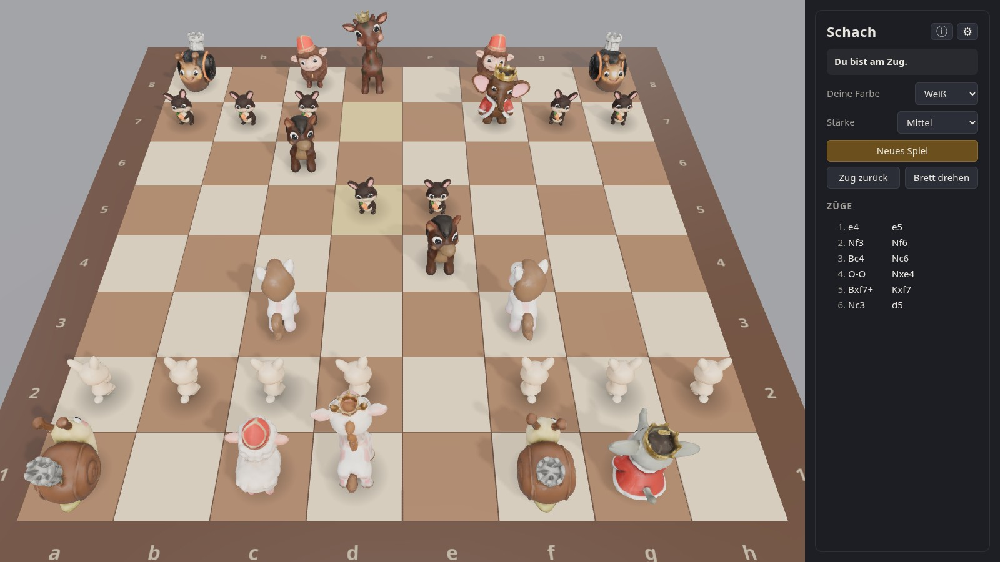
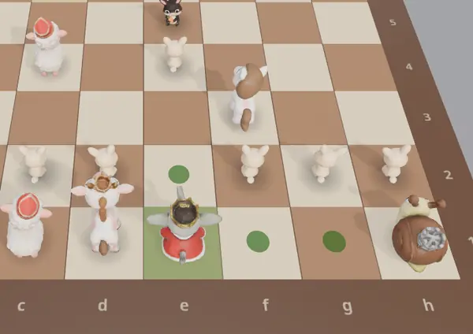
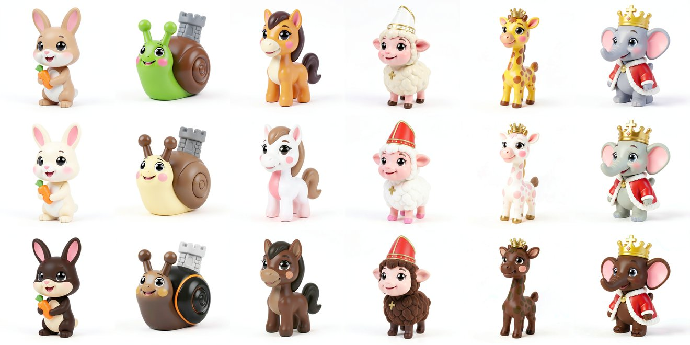
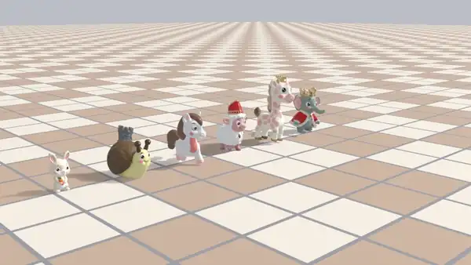

# Schach 3D

Schach gegen den Computer mit animierten 3D-Figuren. Zwei Figurensätze und zwei Bretter sind im Panel
getrennt wählbar: geschnitzte Holzfiguren (Weiß Esche, Schwarz Nussbaum) auf einem Schnitzbrett, oder
Tierfiguren auf einem Spielzeugbrett. Die Figuren laufen zu ihrem Zielfeld, der Hasen-Bauer hüpft.

## Starten

Linux/macOS: `./start.sh`, Windows: Doppelklick auf `start.bat`. Beim ersten Start werden die
Abhängigkeiten und Chromium automatisch installiert (Node.js muss vorhanden sein).

## Erstellung des Spiels

Der Code und die 3D-Figuren sind per Agent Coding mit **Claude Code** entstanden.
Für die Figuren hat Claude Code Aufgaben an einen Remote-Rechner delegiert, einen **Asus Ascent GX10**
(NVIDIA GB10), auf dem lokale KI-Modelle eingerichtet sind. Server, Werkzeuge und das Claude-Code-Plugin
mit den Skills dafür stammen aus [gb10-assets](https://github.com/StefanMenne/gb10-assets). Über die
Skills weiß Claude Code, wie es auf den Rechner zugreift und die Werkzeuge dort ausführt.

Die Werkzeuge, die lokal betrieben wurden, sind:
 - Qwen-Image-2512 und Qwen-Image-Edit-2511
 - Pixal3D auf TRELLIS.2 in ComfyUI
 - Blender

1. **Bildvorlagen:** Aus groben Ideen erzeugt Qwen-Image Varianten jeder Figur, die Schnitzfiguren
   frontal, die Tierfiguren in Dreiviertelansicht. Jede Figur gibt es als eigenes Modell in Weiß und
   Schwarz; die schwarze Vorlage entsteht per Qwen-Image-Edit aus der gewählten weißen (gleiche Pose,
   andere Farben).
2. **3D-Modell:** ComfyUI macht mit seiner Workflow-Vorlage „Pixal3D & TRELLIS.2: Image to Model“ aus
   einem einzigen Bild ein texturiertes 3D-Mesh.
3. **Nachbearbeitung in Blender**, per Skript ohne Oberfläche (`tools/`): Texturfarben angleichen, Augen
   der Tiere nachbessern, Skelett einsetzen und die Bewegungen berechnen. Alle Skelette und Animationen
   sind mit eigenen Skripten erzeugt, ohne fremde Animationsdaten (kein Mixamo):
   - Schnitzfiguren: `rig_figur.py` setzt ein Menschen-Skelett aus einem Profil ein, `anim_figur.py`
     berechnet `Idle` und `WalkInPlace` (Füße als IK-Ziele mit Bodenkontakt, eigene Zwei-Knochen-IK) und
     speichert die Schrittlänge an der Figur, `anim_splice.py` setzt die Bewegungen ein, ohne Mesh und
     Material anzufassen. Der Turm (Rundturm auf einem Wagen) hat rollende Räder aus `rig_turm.py`.
   - Tierfiguren: Vierbeiner, Zweibeiner und Schnecke, Ablauf in `tools/tierschach/LIESMICH.md`.
4. **Spiel:** Ebenfalls mit Claude Code geschrieben, im Browser mit JavaScript.
   - **Grafik:** Three.js lädt die Figuren als glTF und spielt ihre Animationen ab. Die Laufgeschwindigkeit
     ergibt sich aus der Schrittlänge, damit die Füße nicht rutschen. Beleuchtet wird mit einer
     Studio-Umgebung (RoomEnvironment) und einer Sonne für die Schatten. Helligkeit von Licht, Figuren und
     Brett ist im Panel unter „Weitere Einstellungen“ einstellbar. Die Kamera ist frei drehbar.
   - **Regeln:** chess.js erzeugt die legalen Züge und erkennt Schach, Matt und Remis. Damit sind auch
     Rochade, en passant und Bauernumwandlung abgedeckt. Eine Engine hat chess.js selbst nicht.
   - **Computergegner:** Von Opus 5.5 programmiert auf Basis von Tomasz Michniewskis
     [Simplified Evaluation Function](https://www.chessprogramming.org/Simplified_Evaluation_Function).
     Die Suche ist ein Negamax mit Alpha-Beta-Schnitten, iterativer Vertiefung,
     Ruhesuche über Schlagzüge (damit Abtausche nicht mittendrin abgebrochen werden) und Zugsortierung
     (Schlagzüge nach dem Prinzip „wertvolles Opfer, billiger Angreifer“ zuerst). Bewertet werden
     Material und Figuren-Feld-Tabellen, mit eigener Königstabelle fürs Endspiel.
     Die vier Spielstufen unterscheiden sich in Suchtiefe (1 bis 5 Halbzüge), Bedenkzeit (0,3 bis 5
     Sekunden) und einem Zufallsanteil, der auf den unteren Stufen Fehler einbaut.
   - **Tests:** Playwright prüft das Spiel im echten Browser, unter anderem Sonderzüge, Matterkennung,
     Zugrücknahme und ob der Computer ein Matt in einem Zug findet.

Die Bilder und Videos unter `docs/` zeigen noch die erste Fassung der Tierfiguren.

## Aufbau

| Pfad | Inhalt |
|---|---|
| `public/main.js` | Szene, Licht, Bretter, Spielablauf, Bedienung |
| `public/models.js` | Figuren laden, Animationen abspielen, Laufen und Hüpfen |
| `public/ai-worker.js` | Computergegner (Alpha-Beta-Suche im Web Worker) |
| `public/assets/sets/schnitz/*.glb` | die zwölf Schnitzfiguren mit Skelett und Animationen |
| `public/assets/sets/tiere/*.glb` | die zwölf Tierfiguren mit Skelett und Animationen |
| `public/assets/board/` | Bild des Schnitzbretts (das Spielzeugbrett wird im Code gebaut) |
| `public/licenses/` | Lizenztexte, die der Info-Dialog anzeigt |
| `tools/` | Blender- und Python-Skripte für Rig und Bewegungen |
| `server.js`, `start.js` | kleiner Webserver ohne Abhängigkeiten, Startfenster |
| `tests/` | Playwright-Tests |
| `docs/` | Bilder und Videos für diese Seite |

## Verwendete Werkzeuge und Lizenzen

Die vollständigen Lizenztexte liegen in [`public/licenses/`](public/licenses/) und sind im Spiel über
den Info-Dialog (ⓘ) erreichbar.

### Im Spiel enthalten

| Komponente | Version | Lizenz | Quelle |
|---|---|---|---|
| three.js | 0.186.1 | MIT | https://github.com/mrdoob/three.js |
| chess.js | 1.4.0 | BSD-2-Clause | https://github.com/jhlywa/chess.js |
| Playwright (Startfenster, Tests) | 1.64.1 | Apache-2.0 | https://github.com/microsoft/playwright |

### Zur Erzeugung der Figuren verwendet

Keine dieser Komponenten wird mit dem Spiel ausgeliefert, nur die damit erzeugten Figuren.

| Komponente | Wofür | Lizenz | Quelle |
|---|---|---|---|
| Claude Code (Anthropic) | Steuerung der Werkzeuge, Skripte, Spielcode | Nutzungsbedingungen von Anthropic | https://claude.com/claude-code |
| Qwen-Image-2512 (Alibaba Qwen) | Bildvorlagen | Apache-2.0 | https://huggingface.co/Qwen/Qwen-Image-2512 |
| Qwen-Image-Edit-2511 (Alibaba Qwen) | schwarze Fassungen, Bildkorrekturen | Apache-2.0 | https://huggingface.co/Qwen/Qwen-Image-Edit-2511 |
| Diffusers | Qwen-Image ausführen | Apache-2.0 | https://github.com/huggingface/diffusers |
| Pixal3D auf TRELLIS.2 | Bild → 3D-Mesh mit Textur | MIT | https://huggingface.co/Comfy-Org/Pixal3D |
| ComfyUI 0.42.1 | Pixal3D ausführen | GPL-3.0 (gilt nicht für erstellte Dateien) | https://github.com/Comfy-Org/ComfyUI |
| Blender 5.2.2 LTS | Nachbearbeitung, Rig, Animationen, Video | GPL-3.0-or-later (gilt nicht für erstellte Dateien) | https://www.blender.org |

## Lizenz

Für dieses Projekt wird keine Lizenz vergeben, alle Rechte vorbehalten. Die eingebundenen Bibliotheken
und verwendeten Werkzeuge stehen unter ihren jeweiligen Lizenzen (siehe oben).
