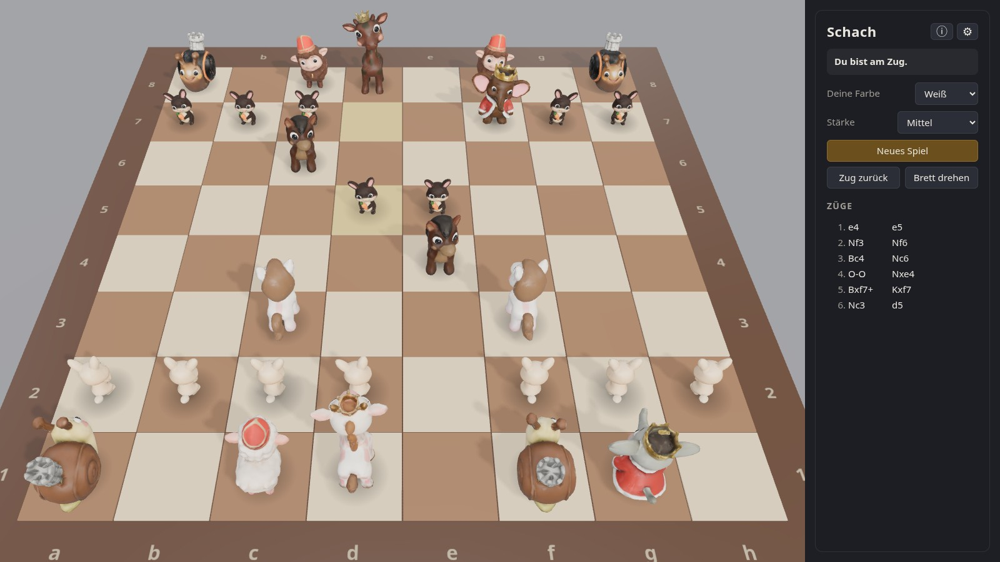
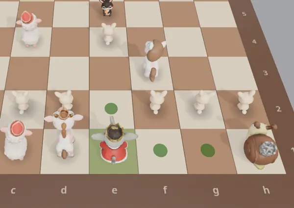
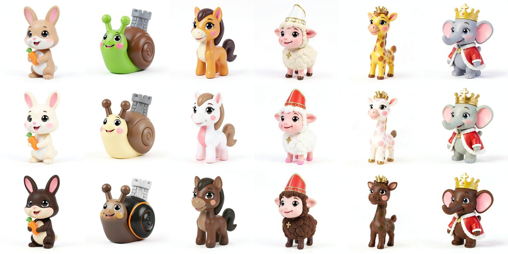
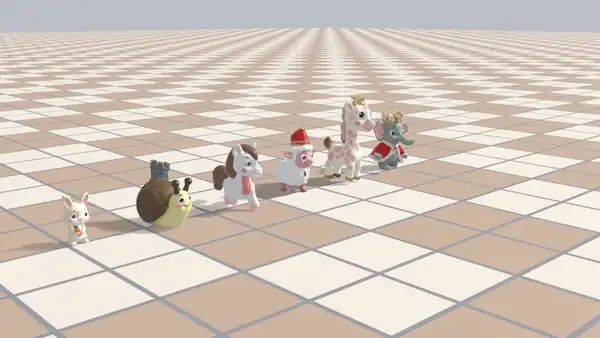

# Schach 3D

## Starten

Linux/macOS: `./start.sh`, Windows: Doppelklick auf `start.bat`. Beim ersten Start werden die
Abhängigkeiten und Chromium automatisch installiert (Node.js muss vorhanden sein).

## Erstellung des Spiels

Der Code und die 3D-Figuren sind per Agent Coding mit **Claude Code** entstanden.
Für die Figuren hat Claude Code Aufgaben an einen Remote-Rechner delegiert, einen **Asus Ascent GX10**
(NVIDIA GB10), auf dem lokale KI-Modelle eingerichtet sind. Server, Werkzeuge und das Claude-Code-Plugin
mit den Skills dafür stammen aus [gb10-assets](https://github.com/StefanMenne/gb10-assets). Über die
Skills weiß Claude Code, wie es auf den Rechner zugreift und die Werkzeuge dort ausführt.

Die Werkzeuge, die lokal betrieben wurden, sind:
 - FLUX.2 [klein]
 - ComfyUI
 - Blender

1. **Bildvorlagen:** Aus groben Ideen erzeugt FLUX.2 [klein] Varianten jeder Figur im Look von
   Spielzeugfiguren, ohne Konturen und in Dreiviertelansicht. Daraus entstehen je eine weiße und eine
   schwarze Fassung.
2. **3D-Modell:** ComfyUI macht mit seiner Workflow-Vorlage „Pixal3D & TRELLIS.2: Image to Model“ aus
   einem einzigen Bild ein texturiertes 3D-Mesh.
3. **Nachbearbeitung in Blender**, per Skript ohne Oberfläche: Texturfarben korrigieren, Augen
   nachbessern, Skelett einsetzen (Vierbeiner, Zweibeiner, Schnecke) und die Animationen `Idle` und `Walk`
   berechnen. Beine werden per inverser Kinematik geführt, damit die Füße beim Laufen am Boden bleiben.
4. **Spiel:** Ebenfalls mit Claude Code geschrieben, im Browser mit JavaScript.
   - **Grafik:** Three.js lädt die Figuren als glTF, spielt ihre `Idle`- und `Walk`-Animationen ab und
     stellt die Szene mit Schatten und frei drehbarer Kamera dar.
   - **Regeln:** chess.js erzeugt die legalen Züge und erkennt Schach, Matt und Remis. Damit sind auch
     Rochade, en passant und Bauernumwandlung abgedeckt. Eine Engine hat chess.js selbst nicht.
   - **Computergegner:** Von Opus 5.5 programmiert auf Basis von Tomasz Michniewskis
     [Simplified Evaluation Function](https://www.chessprogramming.org/Simplified_Evaluation_Function).
     Die Suche ist ein Negamax mit Alpha-Beta-Schnitten, iterativer Vertiefung,
     Ruhesuche über Schlagzüge (damit Abtausche nicht mittendrin abgebrochen werden) und Zugsortierung
     (Schlagzüge nach dem Prinzip „wertvolles Opfer, billiger Angreifer“ zuerst). Bewertet werden
     Material und Figuren-Feld-Tabellen, mit eigener Königstabelle fürs Endspiel.
     Die vier Spielstufen unterscheiden sich in Suchtiefe (1 bis 5 Halbzüge), Bedenkzeit (0,3 bis 5
     Sekunden) und einem Zufallsanteil, der auf den unteren Stufen Fehler einbaut.
   - **Tests:** Playwright prüft das Spiel im echten Browser, unter anderem Sonderzüge, Matterkennung,
     Zugrücknahme und ob der Computer ein Matt in einem Zug findet.

## Aufbau

| Pfad | Inhalt |
|---|---|
| `public/main.js` | Szene, Figuren, Animationen, Bedienung |
| `public/ai-worker.js` | Computergegner (Alpha-Beta-Suche im Web Worker) |
| `public/licenses/` | Lizenztexte, die der Info-Dialog anzeigt |
| `pieces/*.glb` | die zwölf Figuren mit Skelett und Animationen |
| `server.js`, `start.js` | kleiner Webserver ohne Abhängigkeiten, Startfenster |
| `tests/` | Playwright-Tests |
| `docs/` | Bilder und Videos für diese Seite |

## Verwendete Werkzeuge und Lizenzen

Die vollständigen Lizenztexte liegen in [`public/licenses/`](public/licenses/) und sind im Spiel über
den Info-Dialog (ⓘ) erreichbar.

### Im Spiel enthalten

| Komponente | Version | Lizenz | Quelle |
|---|---|---|---|
| three.js | 0.186.1 | MIT | https://github.com/mrdoob/three.js |
| chess.js | 1.4.0 | BSD-2-Clause | https://github.com/jhlywa/chess.js |
| Playwright (Startfenster, Tests) | 1.64.1 | Apache-2.0 | https://github.com/microsoft/playwright |

### Zur Erzeugung der Figuren verwendet

Keine dieser Komponenten wird mit dem Spiel ausgeliefert, nur die damit erzeugten Figuren.

| Komponente | Wofür | Lizenz | Quelle |
|---|---|---|---|
| Claude Code (Anthropic) | Steuerung der Werkzeuge, Skripte, Spielcode | Nutzungsbedingungen von Anthropic | https://claude.com/claude-code |
| FLUX.2 [klein] 4B (Black Forest Labs) | Bildvorlagen | Apache-2.0 | https://huggingface.co/black-forest-labs/FLUX.2-klein-4B |
| Diffusers | FLUX ausführen | Apache-2.0 | https://github.com/huggingface/diffusers |
| ComfyUI 0.42.1 | Bild → 3D-Mesh mit Textur | GPL-3.0 (gilt nicht für erstellte Dateien) | https://github.com/Comfy-Org/ComfyUI |
| Blender 5.2.2 LTS | Nachbearbeitung, Rig, Animationen, Video | GPL-3.0-or-later (gilt nicht für erstellte Dateien) | https://www.blender.org |

## Lizenz

Für dieses Projekt wird keine Lizenz vergeben, alle Rechte vorbehalten. Die eingebundenen Bibliotheken
und verwendeten Werkzeuge stehen unter ihren jeweiligen Lizenzen (siehe oben).
