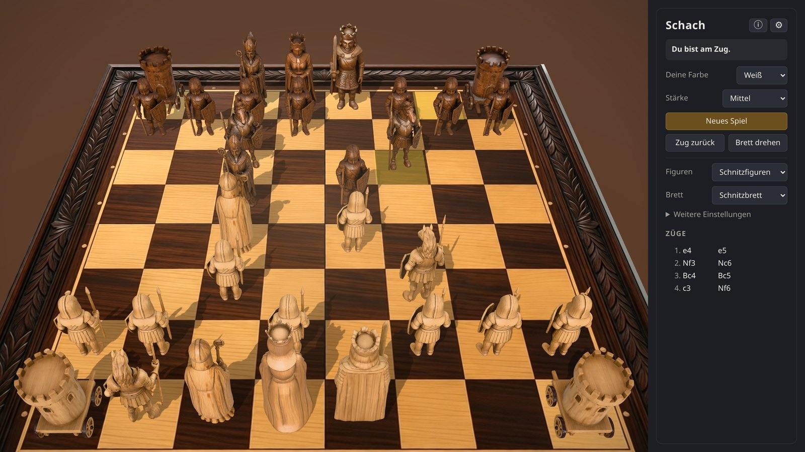
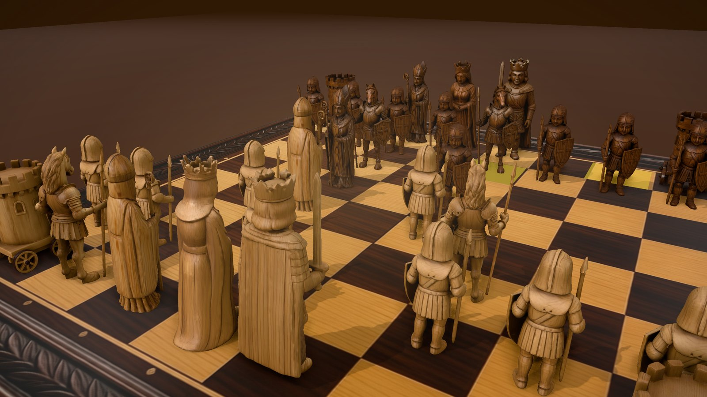
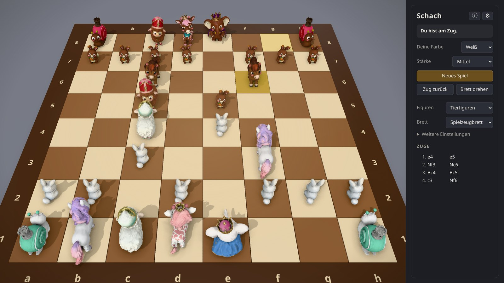

# Schach 3D

Schach gegen den Computer im Browser, mit animierten 3D-Figuren, die zu ihrem Zielfeld gehen. Der Code
ist per Agent Coding mit Claude Code entstanden, die Figuren mit lokal betriebenen KI-Werkzeugen.

## Starten

Linux/macOS: `./start.sh`, Windows: Doppelklick auf `start.bat`. Beim ersten Start werden die
Abhängigkeiten und Chromium automatisch installiert (Node.js muss vorhanden sein).

## Funktionen

- Vollständige Schachregeln einschließlich Rochade, en passant, Bauernumwandlung und Remisregeln
- Computergegner in vier Stärken, Spiel mit Weiß oder Schwarz, Zugrücknahme, Zugliste
- Frei drehbare Kamera; Figuren gehen über das Brett, der Springer um die Ecke, geschlagene Figuren fallen um
- Figurensatz und Brett getrennt wählbar, Licht und Helligkeit einstellbar (im Browser gespeichert)

## Erstellung

Der Code und die 3D-Figuren sind per Agent Coding mit **Claude Code** entstanden. Für die Figuren hat
Claude Code Aufgaben an einen eigenen Rechner delegiert, einen **Asus Ascent GX10** (NVIDIA GB10), auf
dem die KI-Modelle lokal laufen. Server, Werkzeuge und das Claude-Code-Plugin mit den Skills dafür stammen
aus [gb10-assets](https://github.com/StefanMenne/gb10-assets) (Version 3.0.0). Über die Skills weiß
Claude Code, wie es die Werkzeuge auf dem Rechner aufruft.

1. **Bildvorlagen:** Qwen-Image-2512 erzeugt aus einer Beschreibung Varianten jeder Figur. Jede Figur gibt
   es als eigenes Modell in Weiß und Schwarz; die schwarze Vorlage entsteht per Qwen-Image-Edit-2511 aus
   der gewählten weißen (gleiche Pose, andere Farben). BiRefNet stellt die Figur frei.
2. **3D-Modell:** ComfyUI macht mit seiner Workflow-Vorlage „Pixal3D & TRELLIS.2: Image to Model“ aus
   einem einzigen Bild ein texturiertes 3D-Mesh.
3. **Nachbearbeitung in Blender**, per Skript ohne Oberfläche (`tools/`): Texturfarben angleichen,
   Skelett einsetzen und die Bewegungen berechnen. Alle Skelette und Animationen sind mit eigenen Skripten
   erzeugt, ohne fremde Animationsdaten:
   - `rig_figur.py` setzt ein Menschen-Skelett aus einem Profil ein, `anim_figur.py` berechnet `Idle` und
     `WalkInPlace` (Füße als IK-Ziele mit Bodenkontakt, eigene Zwei-Knochen-IK) und speichert die
     Schrittlänge an der Figur, `anim_splice.py` setzt die Bewegungen ein, ohne Mesh und Material
     anzufassen. Der Turm, ein Rundturm auf einem Wagen, hat rollende Räder aus `rig_turm.py`.
4. **Spiel:** Ebenfalls mit Claude Code geschrieben, im Browser mit JavaScript.
   - **Grafik:** Three.js lädt die Figuren als glTF und spielt ihre Animationen ab. Die Laufgeschwindigkeit
     ergibt sich aus der Schrittlänge, damit die Füße nicht rutschen. Beleuchtet wird mit einer
     Studio-Umgebung (RoomEnvironment) und einer Sonne für die Schatten.
   - **Regeln:** chess.js erzeugt die legalen Züge und erkennt Schach, Matt und Remis. Eine Engine hat
     chess.js selbst nicht.
   - **Computergegner:** Von Opus 5.5 programmiert auf Basis von Tomasz Michniewskis
     [Simplified Evaluation Function](https://www.chessprogramming.org/Simplified_Evaluation_Function).
     Die Suche ist ein Negamax mit Alpha-Beta-Schnitten, iterativer Vertiefung,
     Ruhesuche über Schlagzüge (damit Abtausche nicht mittendrin abgebrochen werden) und Zugsortierung
     (Schlagzüge nach dem Prinzip „wertvolles Opfer, billiger Angreifer“ zuerst). Bewertet werden
     Material und Figuren-Feld-Tabellen, mit eigener Königstabelle fürs Endspiel.
     Die vier Spielstufen unterscheiden sich in Suchtiefe (1 bis 5 Halbzüge), Bedenkzeit (0,3 bis 5
     Sekunden) und einem Zufallsanteil, der auf den unteren Stufen Fehler einbaut.
   - **Tests:** Playwright prüft das Spiel im echten Browser, unter anderem Sonderzüge, Matterkennung,
     Zugrücknahme, ob der Computer ein Matt in einem Zug findet, sowie Figurensätze, Bretter und Licht.

## Figurensätze

| Satz | Brett | Beschreibung |
|---|---|---|
| Schnitzfiguren (Standard) | Schnitzbrett | Mittelalterliche Figuren im Stil geschnitzter Holzfiguren, Weiß Esche, Schwarz Nussbaum |
| Staunton | Schnitzbrett | Klassische Turnierform, gedrechselt (Rotationskörper aus Profilen), Springerkopf als 3D-Modell; Weiß Buchsbaum, Schwarz Ebenholz; die Figuren gleiten, der Springer springt |
| Tierfiguren | Spielzeugbrett | Spielzeugtiere: Hase, Pony, Schaf, Schnecke, Giraffe, Elefant; der Hasen-Bauer hüpft |

Weitere Sätze kommen über `public/assets/sets/<satz>/` und einen Eintrag in `PIECE_SET_LOOK`
(`public/main.js`) hinzu. Der Staunton-Satz entsteht mit `tools/staunton/drehen.py` (Ablauf in
`tools/staunton/LIESMICH.md`), die Tierfiguren mit derselben Pipeline wie die Schnitzfiguren
(`tools/tierschach/LIESMICH.md`).

## Aufbau

| Pfad | Inhalt |
|---|---|
| `public/main.js` | Szene, Licht, Bretter, Spielablauf, Bedienung |
| `public/models.js` | Figuren laden, Animationen abspielen, Laufen und Hüpfen |
| `public/ai-worker.js` | Computergegner (Alpha-Beta-Suche im Web Worker) |
| `public/assets/sets/<satz>/*.glb` | je zwölf Figuren mit Skelett und Animationen |
| `public/assets/board/` | Bild des Schnitzbretts (das Spielzeugbrett wird im Code gebaut) |
| `public/licenses/` | Lizenztexte, die der Info-Dialog anzeigt |
| `tools/` | Blender- und Python-Skripte für Rig und Bewegungen, Bilder für diese Seite |
| `server.js`, `start.js` | kleiner Webserver ohne Abhängigkeiten, Startfenster |
| `tests/` | Playwright-Tests; `docs-bilder.spec.js` erzeugt die Bilder in `docs/` (mit `DOCS=1`) |

## Verwendete Werkzeuge und Lizenzen

Die vollständigen Lizenztexte liegen in [`public/licenses/`](public/licenses/) und sind im Spiel über
den Info-Dialog (ⓘ) erreichbar.

### Im Spiel enthalten

| Komponente | Version | Lizenz | Quelle |
|---|---|---|---|
| three.js | 0.186.1 | MIT | https://github.com/mrdoob/three.js |
| chess.js | 1.4.0 | BSD-2-Clause | https://github.com/jhlywa/chess.js |
| Playwright (Startfenster, Tests) | 1.64.1 | Apache-2.0 | https://github.com/microsoft/playwright |

### Zur Erzeugung der Figuren verwendet

Keine dieser Komponenten wird mit dem Spiel ausgeliefert, nur die damit erzeugten Figuren. Alle liefen
lokal auf dem GB10-Rechner über gb10-assets 3.0.0.

| Komponente | Wofür | Lizenz | Quelle |
|---|---|---|---|
| Claude Code (Anthropic) | Steuerung der Werkzeuge, Skripte, Spielcode | Nutzungsbedingungen von Anthropic | https://claude.com/claude-code |
| gb10-assets 3.0.0 | Server und Claude-Code-Plugin für die Werkzeuge | MIT | https://github.com/StefanMenne/gb10-assets |
| Qwen-Image-2512 (Alibaba Qwen) mit Lightning-LoRA (lightx2v) | Bildvorlagen | Apache-2.0 | https://huggingface.co/Qwen/Qwen-Image-2512 |
| Qwen-Image-Edit-2511 (Alibaba Qwen) mit Lightning-LoRA (lightx2v) | schwarze Fassungen, Bildkorrekturen | Apache-2.0 | https://huggingface.co/Qwen/Qwen-Image-Edit-2511 |
| Diffusers 0.42 | Qwen-Image ausführen | Apache-2.0 | https://github.com/huggingface/diffusers |
| BiRefNet | Freisteller | MIT | https://github.com/ZhengPeng7/BiRefNet |
| Pixal3D (Tencent) | Bild → 3D-Mesh mit Textur | MIT | https://huggingface.co/TencentARC/Pixal3D |
| TRELLIS.2 (Microsoft) | Form und Textur, Grundlage von Pixal3D | MIT | https://github.com/microsoft/TRELLIS.2 |
| MoGe-2 (Microsoft) | Bildwinkel der Vorlage schätzen | MIT | https://github.com/microsoft/MoGe |
| DINOv3 (Meta) | Bild-Encoder in Pixal3D | DINOv3 License | https://github.com/facebookresearch/dinov3 |
| ComfyUI 0.46.0 | Pixal3D ausführen | GPL-3.0 (gilt nicht für erstellte Dateien) | https://github.com/Comfy-Org/ComfyUI |
| Workflow-Vorlage „Pixal3D & TRELLIS.2: Image to Model“ (Comfy Org) | Ablauf Bild → 3D | MIT | https://github.com/Comfy-Org/workflow_templates |
| Blender 5.2.2 LTS | Nachbearbeitung, Rig, Animationen | GPL-3.0-or-later (gilt nicht für erstellte Dateien) | https://www.blender.org |

## Lizenz

Für dieses Projekt wird keine Lizenz vergeben, alle Rechte vorbehalten. Die eingebundenen Bibliotheken
und verwendeten Werkzeuge stehen unter ihren jeweiligen Lizenzen (siehe oben).
